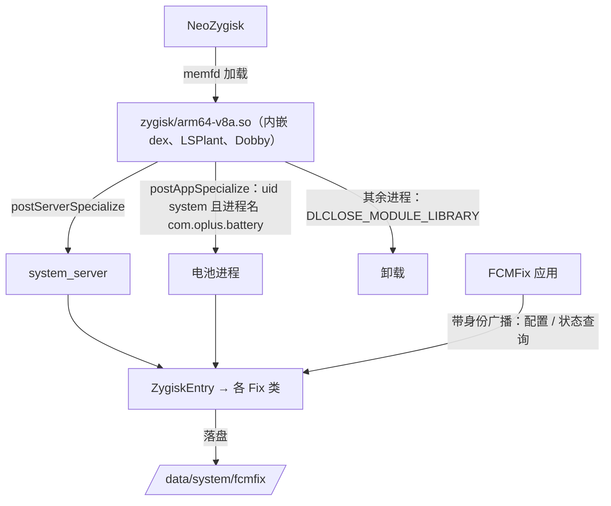

# Zygisk 迁移技术文档

把 FCMFix ColorOS 从“LSPosed/Vector 模块”改为“独立的 NeoZygisk 模块”：不再依赖任何 Xposed 框架，自己完成注入、加载和 ART Hook。
开发顺序与验收见[开发计划](zygisk-dev-plan.md)。

本文的依据是源码和固件的静态分析。标 `[推断]` 的条目没有上机验证过。

## 1. 范围与已定事项

- 目标环境：国行 ColorOS 16 / 17，基线固件 `PJE110_16.0.2.400`。
- Zygisk 实现**只适配 [NeoZygisk](https://github.com/JingMatrix/NeoZygisk)**，不为其他实现做兼容处理，也不测试。
- 必须支持 NeoZygisk 的晚加载（late load，见 5.2）。
- 不保留 LSPosed 入口：迁移完成后删除 `XposedMain`、`META-INF/xposed/` 和 libxposed 依赖。
- APK 放进模块 zip，由安装脚本安装。旧配置不导入。
- 电池组件：包名 `com.oplus.battery`，运行进程 `com.oplus.battery`（已由维护者确认）。
- 本机不编译，全部由 GitHub Actions 构建。
- 现有代码加 [Vector](https://github.com/JingMatrix/Vector) 在基线固件上运行正常，所以 **Hook 点本身不在本次范围内**。
  要关心的只有：Vector 原来替我们做的事，迁移后是否都有等价实现。

## 2. 为什么需要 LSPlant

LSPlant 不是另一个要适配的 Zygisk 实现，而是编进我们自己 so 里的一个库。

NeoZygisk 只负责把模块的 so 送进进程。它提供的 Hook 能力只有两种：替换 JNI native 方法、改写 PLT。
本项目的 40 个 Hook 点全是 `services.jar`、`oplus-services.jar` 里的普通 Java 方法，这两种都够不着，必须有一个 ART 方法 Hook 引擎。

现在这件事由 Vector 做，Vector 内部用的正是 LSPlant（配合 Dobby 做内联 Hook）。离开 Vector 后引擎要自己带。
沿用 Vector 锁定的同一份提交，等于沿用目前在基线固件上跑通的引擎，是风险最低的选择。

## 3. 现在依赖框架的地方

Hook 逻辑已经隔在 `libxposed/XposedBridge` 适配层后面，直接依赖框架的只有下面几处。

| 能力 | 现在由谁提供 | 代码位置 | 迁移后 |
| --- | --- | --- | --- |
| 注入 system_server 和电池进程 | Vector + 作用域 | `META-INF/xposed/scope.list` | 自己的 Zygisk so，按 UID 和进程名判断 |
| 把模块 dex 载入目标进程 | Vector 守护进程 | `META-INF/xposed/java_init.list` | dex 嵌在 so 里，用 `InMemoryDexClassLoader` 加载 |
| 生命周期回调 | `onSystemServerStarting`、`onPackageReady` | `XposedMain.java` | `ZygiskEntry`，见 4.4 |
| Java 方法 Hook、去优化 | `XposedInterface.hook/deoptimize` | `libxposed/XposedBridge.java` | `zygisk.Hooks`，JNI 调 LSPlant |
| 配置读取 | `getRemotePreferences("config")` | `XposedModule.onUpdateConfig` | system_server 自己落盘，应用推送 |
| 配置写入、激活状态、作用域 | `XposedService` | `ui/data/ModuleConnection.kt`（已删除）、`ConfigStore.kt`、`MainViewModel.kt` | 应用本地保存 + 现有的带身份广播 |
| 全局禁止内联 | Vector 的 dex2oat 包装 | 无，隐式依赖 | 见 6.3 |

`XposedBridge.invokeOriginalMethod` 和 `XC_MethodReplacement` 在 Hook 侧没有调用方，切换时直接删除。

## 4. 架构

产物是一个模块 zip（用 KernelSU / APatch / Magisk 的管理器刷入），里面有 so、安装脚本、启动保护脚本和 APK。
APK 只剩界面和配置，不再被注入任何进程。

### 4.1 源码布局

| 路径 | 内容 |
| --- | --- |
| `zygisk/src/module.cpp` | Zygisk 入口：选进程、启动引擎、加载 dex、调用 Java 入口 |
| `zygisk/src/elf_symbols.*` | libart 符号解析：`.dynsym`、`.symtab`、`.gnu_debugdata` |
| `zygisk/src/dex_blob.S` | 把 hook dex 嵌进 so |
| `zygisk/java/.../zygisk/Hooks.java` | 引擎的 Java 侧：回调链、去优化 |
| `zygisk/java/.../zygisk/ZygiskEntry.java` | Java 入口；阶段 1 是探针，阶段 2 换成各 Fix 类 |
| `zygisk/module/` | 模块 zip 的静态文件 |
| `zygisk/external/` | LSPlant、Dobby、xz-embedded 子模块 |
| `zygisk/build.sh`、`.github/workflows/zygisk.yml` | 构建 |

### 4.2 原生加载器

- dex 直接嵌在 so 的只读数据里，进程里不需要读模块目录，所以不使用 `getModuleDir()`，也不受 DenyList 卸载模块挂载的影响。
- `postServerSpecialize`：注入 system_server。
- `postAppSpecialize`：只在 appId 为 1000 且进程名等于 `com.oplus.battery` 时注入，其余进程一律 `setOption(DLCLOSE_MODULE_LIBRARY)`。
- 引擎启动之后**不能**再让 so 被卸载：ART 自身的函数已经跳进这个 so。启动之后的任何失败都只记日志，保留 so。
- so 只导出 `zygisk_module_entry` 一个符号，只依赖系统库（`libc`、`libm`、`libdl`、`liblog`、`libz`）。构建脚本检查这两点，不符合就失败。

### 4.3 Hook 引擎

- [JingMatrix/LSPlant](https://github.com/JingMatrix/LSPlant) `7a768e3` 和 [JingMatrix/Dobby](https://github.com/JingMatrix/Dobby) `05a09ac`，
  是 Vector canary 3118 锁定的提交。升级前先在基线机上回归。
- Maven 上的 `org.lsposed.lsplant` 6.4 只支持到 Android 15 DP1，不能用。
- LSPlant 用 C++23 modules，需要 CMake ≥ 3.28、Ninja ≥ 1.11、NDK r29。
- **LSPlant 每个方法只能 Hook 一次**，而 `broadcastIntentWithFeature` 被注册了两次（`BroadcastFix` 和 `OplusGoogleServiceFix`）。
  `Hooks` 按方法维护回调链：只调一次 `lsplant::Hook`，回调按注册顺序嵌套执行。
- 回调签名是 `Object callback(Object[] args)`，实例方法的 `args[0]` 是 `this`；原方法通过 backup `Method` 反射调用，
  解开 `InvocationTargetException`，保持“框架原异常原样抛出”。

### 4.4 生命周期

- **system_server，开机**：`postServerSpecialize` 时 `services.jar` 还没加载。Hook `ZygoteInit.handleSystemServerProcess`，返回后取线程上下文类加载器，
  再 Hook `SystemServer.startBootstrapServices`，在它执行前安装全部 Hook。时机与 Vector 相同。
- **system_server，晚加载**：见 5.2。
- **电池进程**：Hook `LoadedApk.createOrUpdateClassLoaderLocked`，包名是 `com.oplus.battery` 时安装。
  电池侧的 Hook 目标（`OplusNetworkingControlManager`、`OAppNetControlManager`、`Settings.Global`、`ContextImpl`）都不在 Battery.apk 里。

### 4.5 Context

现在靠 Hook `ContextWrapper.attachBaseContext` 等到第一个 Context。这个方法很短，能否命中取决于内联，时机也不确定。
改为显式获取，在单独的线程上轮询，最长 5 分钟：

- system_server：`activity`、`package`、`user`、`window` 服务都注册之后，取 `ActivityThread.currentActivityThread().getSystemContext()`；
- 电池进程：取 `ActivityThread.currentApplication()`，非空之后才注册接收器；
- 用户还没解锁时只注册解锁广播，解锁后再读配置、注册其余接收器。

### 4.6 配置

不引入守护进程，也不加文件类 SELinux 规则，复用已有的两条带发送方身份校验的广播：

- 应用把配置存在自己的 `SharedPreferences`，变更时和启动时通过 `.update.config` 把完整配置推给 system_server；
- system_server 校验发送方（沿用 `isConfigSender`），用 `ConfigSnapshot` 校验内容，原子写入 `/data/system/fcmfix/config.properties`，开机时从这里读；
- 应用通过 `.query.status` 的应答确认 system_server 实际加载的配置；
- 电池进程不读配置（`OplusBatteryNetworkFix` 没有用到放行列表和选项）。

### 4.7 界面

- 应用不再绑定 `XposedService`：状态页没有单独的“已激活”标志，system_server 应答了状态查询，就说明模块已加载；
- 删除作用域检查和 `requestScope`；状态页的“LSPosed”“作用域”两行改为“Zygisk 模块”，显示版本和是否晚加载；
- 状态应答带模块版本，和 APK 版本不一致时提示重刷模块。

## 5. NeoZygisk 要点

### 5.1 加载方式

- 模块 so 以密封的 memfd 加载，进程里**没有它的磁盘路径**。所以 LSPlant、Dobby、libc++ 全部静态链接，dex 也嵌在里面。
- NeoZygisk 在开机时读一次模块列表。之后给模块目录加 `disable` 要到下次重启才生效。
- 所有模块卸载后 NeoZygisk 才清理注入痕迹，所以非目标进程必须让自己被卸载。
- 只出 `arm64-v8a`。

### 5.2 晚加载（late load）

`ksud late-load`（或手动运行 NeoZygisk 的 `late-load.sh`）会在系统已经启动之后才把 NeoZygisk 装上。这时：

- NeoZygisk 把模块注入**已经在运行的 system_server**，在它自己新建的线程上调用 `postServerSpecialize`；
- `ServerSpecializeArgs.runtime_flags` 带 `1 << 30`；
- 已经在运行的应用进程不会被注入，只有之后新启动的进程才会。

对本项目的影响和处理：

| 问题 | 处理 |
| --- | --- |
| `handleSystemServerProcess`、`startBootstrapServices` 早已执行 | 检测到标志后，从 `ServiceManager.getService("activity")` 的类拿系统类加载器，直接安装 Hook |
| 回调不在主线程，其他线程都在跑 | 安装 Hook 的代码不能假设单线程；`Hooks` 里 backup 的发布要对并发调用安全 |
| `OplusProxyWakeLock` 的构造函数 Hook 不会再触发 | 改从静态字段 `sInstance` 取实例（基线固件上存在） |
| 电池进程已经在运行，不会被注入 | system_server 侧对同一限制有第二道边界（见 7）；状态页标明电池侧未加载。杀掉电池进程后新进程会被注入 `[推断]` |
| 晚加载之前已经发生的限制（如开机探测失败后的禁网） | 不追溯修正；状态页标明“晚加载” |
| 启动保护脚本 | `service.sh` 在系统已启动时立即返回 |

晚加载属于一等场景，阶段 4 有专门的验收。

### 5.3 SELinux

- NeoZygisk 自带 `allow system_server system_server process execmem`。模块自己的 `sepolicy.rule` 仍然写上这一条，不依赖 NeoZygisk 的策略文件。
- `sepolicy.rule` 里**不能出现分号，注释里也不行**：ksud 按换行和分号切分，注释被切开后会被当成规则，导致安装失败。构建脚本会检查。
- 电池进程（`system_app` 域）是否需要额外规则，以上机时的 `avc: denied` 为准 `[推断：Vector 用同一套引擎在该进程工作，应当不需要]`。

### 5.4 隐藏 API

system_server 和平台签名的系统应用不受隐藏 API 限制 `[推断]`。如果上机时在电池进程看到拒绝日志，对自己的 dex 调 `lsplant::MakeDexFileTrusted`。

## 6. 迁移后才出现的风险

### 6.1 启动失败的恢复

system_server 级注入出错就是无法开机，而且不能再到 LSPosed 管理器里关模块。模块 zip 自带两层启动保护：

- `post-fs-data.sh` 记录“已开始但未完成”的开机次数，连续 2 次未完成，第 3 次开机时停用模块；
- `service.sh` 在开机完成前监视 system_server 的 pid。system_server 反复崩溃只会重启 zygote，不会重新执行 `post-fs-data.sh`；
  所以这里数到 3 次重启就停用模块并重启手机。开机完成后清零计数。

原生层在读不到 libart 符号时直接放弃并允许卸载；引擎启动之后的失败只记日志。

### 6.2 版本错配与重复注入

- 模块里的 Hook 代码和 APK 来自同一个 zip；用户单独更新 APK 时可能不一致，所以状态应答带版本号，界面检查。
- 用户可能同时保留旧版（在 Vector 中启用）和新模块：新入口在安装 Hook 前检查进程内标记，已存在就放弃并记日志；发布说明要求先停用旧版。

### 6.3 内联

Vector 通过包装 dex2oat 给**设备上的编译**加了 `--inline-max-code-units=0`。迁移后没有这一层：

- system_server 的几个 jar 用的是固件预编译产物，内联情况与 Vector 下相同，现有的“Hook Binder 入口和大方法 + 去优化调用方”继续有效；
- 设备上重新编译过的 APK（如 OTA 后的 Battery.apk）迁移后可能内联框架里的短方法。电池侧的 `setUidPolicy`（48 条指令）和
  `networkDisableWhiteList`（30 条）属于这一类。基线固件上后者是反射调用，不会内联；两者在 system_server 侧也都有第二道边界。

不随模块下发全局禁内联参数（影响全机性能，且要重新编译才生效）。阶段 2 用同一台机器对比 Vector 与 Zygisk 两种方式下各 Hook 的命中日志，
出现差异再对具体调用方做去优化。

### 6.4 许可证

项目是 MIT。LSPlant 是 LGPL-3.0，静态链接时要保证用户能重新链接（源码和构建脚本公开即可），并写入 `NOTICE`。
Dobby 是 Apache-2.0，xz-embedded 是 0BSD。Vector 的原生代码是 GPL-3.0，**只参考做法，不复制代码**。

## 7. 基线固件 PJE110_16.0.2.400

`firmware/` 下五个文件的静态核对结果（该目录已加入 `.gitignore`，不提交）。

- 当前会安装的 40 个 Hook 方法全部存在，签名与代码中的判定一致。
- 两处按现有逻辑会记为“不适用”：没有 `MaliciousRestrictPolicy`（只有 `preventByMaliciousCompStartegy(int,int,String,String)`，唯一调用方是 `shouldPreventStartActivity`）；
  没有 `OplusHansConnectivityManager`，`OplusHansManager` 也没有名字含 weak 的成员。
- 入口形态：强停入口是 `OsenseResManagerService$3.requestSceneAction(Bundle): void`；`HansCGroup.FastFreezeEnter(int)`；
  `ActivityManagerService.broadcastIntentWithFeature` 只是转发给 `BroadcastController`；`OplusDeviceIdleHelper` 在 jobscheduler jar 中。
- 很短、容易被内联的 Hook 方法：`getGoogleRestrictSwitch`、`isGoogleRestrct`（各 3 条指令），`isAllowStartFromBindService`、`shouldPreventSendReceiver`（各 5 条，都是转发）。
  它们在 Vector 下的命中情况就是迁移后的预期。
- `Battery.apk`（1.2.8）共享 `android.uid.system`，清单声明了 `IgnoreGmsUserSet=true`，但它的 dex 里没有 `google_restrict_change`、`setUidPolicy` 等字符串：
  这个固件上，电池侧“GMS 联网策略”和“限制广播”两组 Hook 在 Battery.apk 内没有触发点，起作用的是 system_server 侧的边界。
- 晚加载需要的 `OplusProxyWakeLock.sInstance` 存在。

## 8. 待上机确认

| 项 | 怎么确认 | 阶段 |
| --- | --- | --- |
| 引擎脱离 Vector 后能否在基线机上启动 | 刷入阶段 1 的 zip，看 `fcmfix-zygisk` 和 `fcmfix` 日志 | 1 |
| 电池进程是否需要额外 SELinux 规则 | 同上，看 `avc: denied` | 1 |
| 隐藏 API 是否拦截自己的 dex | 同上，看 `Accessing hidden` 日志 | 1 |
| 晚加载后杀掉电池进程，新进程是否被注入 | `ksud late-load` 后 `am force-stop com.oplus.battery` | 4 |
| 短方法 Hook 的命中是否与 Vector 下一致 | 同机对比日志 | 2 |

## 9. 参考

- [NeoZygisk](https://github.com/JingMatrix/NeoZygisk)：`loader/src/injector/module.cpp`、`system_server.cpp`、`loader/src/ptracer/stage.cpp`、`module/src/sepolicy.rule`
- [Vector](https://github.com/JingMatrix/Vector)：`zygisk/src/main/cpp/module.cpp`、`xposed/.../SystemServerHookers.kt`、`VectorStartup.kt`、`dex2oat/README.md`
- [Zygisk API 头文件](https://github.com/topjohnwu/zygisk-module-sample)
